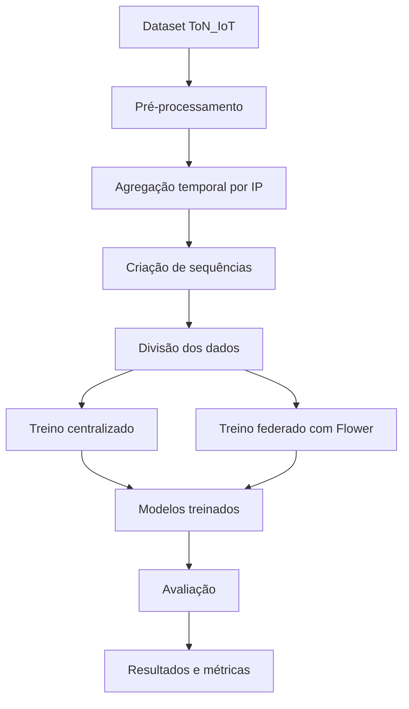

# Arquitetura do Sistema

[← Voltar à documentação](README.md)

## 1. Visão geral

O projeto **SRSI — IoT Anomaly Detection** tem como objetivo estudar a deteção de anomalias em tráfego de redes IoT, comparando modelos de aprendizagem profunda em dois cenários:

- **Aprendizagem centralizada:** os modelos são treinados num único processo, com acesso ao conjunto de treino completo.
- **Aprendizagem federada:** os dados são distribuídos por cinco clientes lógicos, que treinam localmente os modelos. Um servidor agrega as atualizações através do algoritmo **FedAvg**, utilizando a framework **Flower**.

As arquiteturas analisadas são **GRU, LSTM e Transformer**.

## 2. Fluxo de funcionamento

O sistema transforma registos de tráfego em sequências temporais e utiliza modelos neuronais para classificar cada sequência como normal ou anómala.

## 3. Organização do código

| Diretório | Responsabilidade |
|---|---|
| `src/preprocessing/` | Exploração, análise e preparação dos dados |
| `src/models/` | Implementação das arquiteturas GRU, LSTM e Transformer |
| `src/training/` | Treino centralizado |
| `src/federated/` | Treino federado, clientes, servidores e FedAvg |
| `src/evaluation/` | Avaliação e comparação de modelos |
| `configs/` | Configurações experimentais |
| `tests/` | Testes e verificações |
| `data/` | Dados originais e processados |
| `results/` | Checkpoints, métricas, tabelas e figuras |

Os módulos Python são executados a partir da raiz do projeto, geralmente através de `python -m`.

## 4. Representação dos dados

As experiências V2-B e V2-C utilizam sequências de **cinco janelas temporais de um minuto**, associadas ao mesmo IP de origem.

Cada minuto é representado por seis características:

1. Número de ligações.
2. Soma dos bytes enviados pela origem.
3. Soma dos bytes enviados pelo destino.
4. Soma dos pacotes enviados pela origem.
5. Soma dos pacotes enviados pelo destino.
6. Duração média das ligações.

Os modelos recebem tensores com dimensões `(N, 5, 6)`.

A classificação binária indica a existência de ligações maliciosas no último minuto da sequência.

## 5. Modelos de aprendizagem profunda

As arquiteturas encontram-se nos seguintes ficheiros:

- `src/models/gru.py`
- `src/models/lstm.py`
- `src/models/transformer.py`

Nas experiências V2-C, os modelos utilizam uma dimensão oculta de 32. O Transformer utiliza quatro cabeças de atenção.

Estes módulos são partilhados pelo treino centralizado, pelo treino federado e pela avaliação.

## 6. Aprendizagem centralizada

O treino centralizado utiliza PyTorch e o otimizador Adam.

Os principais scripts são:

| Script | Finalidade |
|---|---|
| `src/training/train_v2.py` | Treino V2-B |
| `src/training/train_v2c.py` | Treino com validação interna V2-C |
| `src/training/train_v2c_final.py` | Treino definitivo V2-C |

Na fase final V2-C, o número de épocas foi definido previamente, sem utilizar os dados reservados de avaliação para selecionar hiperparâmetros.

## 7. Aprendizagem federada

A implementação utiliza **Flower**, com agregação **FedAvg**.

Cada cliente:

1. Recebe os parâmetros globais.
2. Treina localmente durante uma época.
3. Envia os parâmetros atualizados ao servidor.

O servidor agrega as atualizações, ponderando-as pelo número de exemplos de cada cliente.

Os principais ficheiros da experiência V2-C final são:

| Componente | Ficheiro |
|---|---|
| Particionamento | `src/federated/create_v2c_final_client_partitions.py` |
| Cliente | `src/federated/flower_client_v2c_final.py` |
| Servidor | `src/federated/flower_server_v2c_final.py` |
| Simulação | `src/federated/run_flower_simulation_v2c_final.py` |

São utilizados cinco clientes lógicos com diferentes proporções de tráfego normal e malicioso.

**Importante:** um cliente lógico não corresponde necessariamente a um dispositivo físico. Além disso, FedAvg, por si só, não garante privacidade nem segurança.

## 8. Experiências realizadas

### V2-B — Divisão temporal

Os dados foram divididos em treino, validação e teste com base nas datas.

Esta experiência permitiu comparar modelos centralizados e federados, mas revelou limitações relacionadas com a distribuição dos IPs, particularmente a sobreposição entre os IPs de treino e validação.

### V2-C — Generalização para IPs não vistos

Esta experiência procurou avaliar o desempenho em IPs de origem ausentes do treino.

Foram utilizados:

- 30 IPs para treino interno.
- 7 IPs para validação interna.
- 37 IPs para treino final.
- 3 IPs reservados para avaliação final.

O protocolo final foi registado em `results/v2c_final_protocol.json` antes da avaliação.

| Modelo | Épocas centralizadas | Rondas federadas |
|---|---:|---:|
| GRU | 1 | 15 |
| LSTM | 1 | 4 |
| Transformer | 1 | 3 |

Foram utilizadas três seeds: **42, 123 e 2026**, e um limiar de classificação de **0,5**.

### Demonstração federada e cliente malicioso

Como extensão experimental de segurança, foi
implementada uma demonstração com Flower e FedAvg,
utilizando uma GRU e cinco clientes lógicos.

A demonstração distingue dois cenários:

- **Benigno:** os cinco clientes enviam os parâmetros
  resultantes do treino local.
- **Adversarial:** quatro clientes enviam parâmetros
  legítimos, enquanto o cliente 4 modifica a sua
  atualização antes de a enviar ao servidor.

O funcionamento do cenário adversarial é:

1. O servidor distribui os parâmetros globais.
2. Os cinco clientes executam uma época de treino local.
3. O cliente 4 calcula a sua atualização adulterada.
4. O servidor agrega os cinco conjuntos de parâmetros
   através do FedAvg convencional.
5. O processo repete-se durante 20 rondas.

O cliente malicioso calcula os parâmetros enviados por:

θ_mal = θ_global + α × (θ_local - θ_global)

em que **α = -10**.

Este fator inverte o sentido da atualização local
e amplifica a sua magnitude dez vezes.

A adulteração é aplicada aos parâmetros do modelo,
não aos dados nem às etiquetas de treino, sendo
classificada como **model poisoning**.

O servidor não implementa mecanismos específicos
de identificação ou rejeição de clientes maliciosos.

Os componentes principais estão em `src/federated/`:

| Componente | Ficheiro |
|---|---|
| Execução benigna | `demo_20rounds_benign.py` |
| Servidor benigno | `demo_20rounds_benign_server.py` |
| Cliente legítimo | `demo_flower_client.py` |
| Execução adversarial | `demo_20rounds_malicious.py` |
| Servidor adversarial | `demo_20rounds_malicious_server.py` |
| Cliente malicioso | `demo_malicious_client.py` |

Esta experiência utiliza 15 951 janelas de treino
interno e 5 060 janelas de validação interna.

Os três IPs reservados para a avaliação final V2-C
não são utilizados nesta demonstração.

Os resultados da experiência de segurança são
independentes dos 18 checkpoints finais V2-C.

Para instruções de execução, resultados e limitações,
consultar [Demonstração federada e segurança](federated-security-demo.md).

---

## 9. Avaliação e armazenamento dos resultados

A avaliação final encontra-se implementada em:

`src/evaluation/evaluate_v2c_final.py`

Foram avaliadas **4 256 janelas provenientes de três IPs reservados**, utilizando os 18 checkpoints definitivos.

As principais métricas são accuracy, precision, recall, F1-score e taxa de falsos positivos (FPR).

Os resultados encontram-se em:

- `results/models/` — modelos centralizados.
- `results/federated/` — experiências federadas.
- `results/tables/` — métricas e comparações.
- `results/figures/` — figuras.
- `results/v2c_final_results_consolidated.json` — resultados finais consolidados.

## 10. Limitações e manutenção

A experiência V2-C avalia a generalização para três IPs de origem específicos e não demonstra generalização temporal ou para qualquer dispositivo IoT.

Os IPs reservados foram escolhidos após análise das suas distribuições. Além disso, as janelas temporais sobrepostas não são estatisticamente independentes.

Os scripts utilizam imports e caminhos específicos. Por esse motivo, qualquer alteração à estrutura de `src/`, `data/` ou `results/` deve ser acompanhada pela atualização das dependências e por testes de integridade.

Os resultados finais estão congelados e não devem ser utilizados para reajustar os modelos.

---

[← Voltar à documentação](README.md)